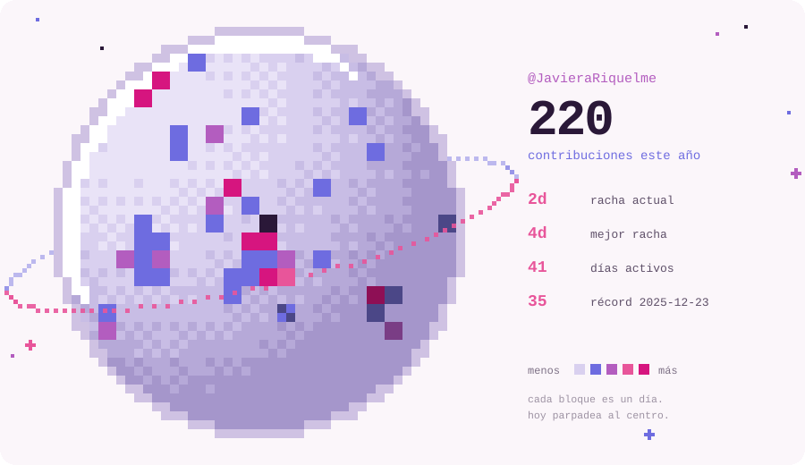
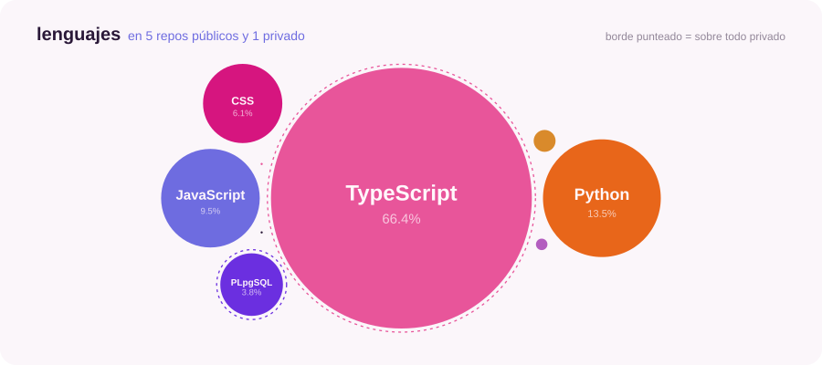

<picture>
  <source media="(prefers-color-scheme: dark)" srcset="https://raw.githubusercontent.com/JavieraRiquelme/JavieraRiquelme/main/assets/planet-dark.svg">
  
</picture>

<picture>
  <source media="(prefers-color-scheme: dark)" srcset="https://raw.githubusercontent.com/JavieraRiquelme/JavieraRiquelme/main/assets/neurons-dark.svg">
  
</picture>

<picture>
  <source media="(prefers-color-scheme: dark)" srcset="https://raw.githubusercontent.com/JavieraRiquelme/JavieraRiquelme/main/assets/languages-dark.svg">
  
</picture>

